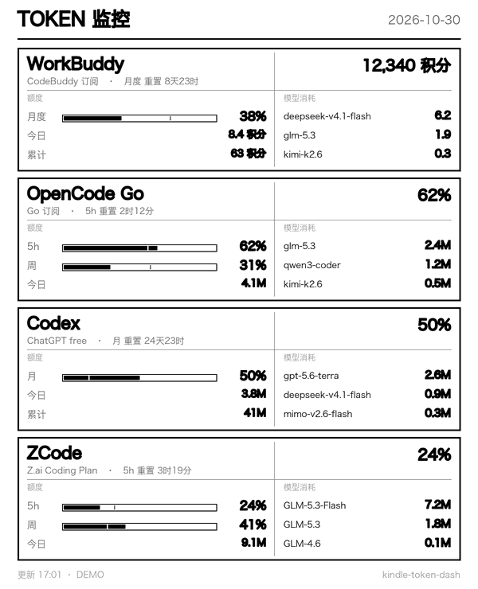

# quota-glance

[](https://github.com/questionjie-max/quota-glance/actions/workflows/test.yml)

**把 AI 订阅额度做成一块"一眼看"的屏。** 电脑采集 → 渲染灰度 PNG → 不越狱的 Kindle（或任何浏览器）拉取。

左边是额度窗口（5 小时 / 周 / 月，带时间进度尺），右边是**按模型拆开的消耗**——谁吃得最多，一眼看到。



<sub>演示数据。真机上 600×800 屏、16 级灰。</sub>

> **English TL;DR** — Turn a spare Kindle (or any browser) into an always-on e-ink dashboard for
> AI subscription quotas. Instead of re-implementing cookie/OAuth scraping per provider, it reads
> the already-normalised local quota store of [Magpie](https://magpie.com) and falls back to local
> usage tables for per-model breakdowns. Pure stdlib + Pillow. Kindle端不需要越狱。

---

## 为什么还要做这个

这个赛道的成熟项目已经不少（[hal9-dk](https://github.com/hal9-dk/kindle-usage-dashboard)、
[alexishida](https://github.com/alexishida/kindle-dashboard)、
[ethangreeney](https://github.com/ethangreeney/kindle-usage-ledger)、
[STARKTANG108](https://github.com/STARKTANG108/kindle-token-panel) 等）。
它们把大量精力花在**怎么拿到额度数据**上——每家自己复刻一套 cookie 抓取、OAuth 刷新、429 退避。

这套东西的思路不同：**不要把凭据层再造一遍。**

```
        ┌─────────────────────┐         ┌──────────────────┐
 各家   │  Magpie（桌面聚合器）│  本地    │  quota-glance     │
 额度   │  已经归一化好了      │──JSON──▶│  · 补按模型明细   │
 接口   │  ~/.config/magpie/  │         │  · 渲染 PNG       │
        └─────────────────────┘         │  · 304 防闪服务   │
                  ▲                     └────────┬─────────┘
                  │ 凭据/刷新/退避                │ HTTP
             （不用我们管）                       ▼
                                        Kindle 体验版浏览器（不越狱）
```

这和 Prometheus 与 exporter 的分工是同构的：**exporter 管取数，dashboard 管显示。**
好处是新增 provider 不用改这里，接口改版也只在一处修。

## 快速开始

只需要 Python 3.9+ 和 Pillow。

```bash
pip install pillow
git clone https://github.com/questionjie-max/quota-glance.git
cd quota-glance

python -m quota_glance serve --demo     # 假数据，先看效果
python -m quota_glance serve            # 真实数据
```

```
  本机   http://127.0.0.1:8787
  局域网 http://192.168.1.23:8787      <- Kindle 浏览器里输这个
```

### 三个子命令

| 命令 | 作用 |
|---|---|
| `python -m quota_glance json` | **只输出规范 JSON**——exporter 层的产物，可以喂给 Grafana / 网页 / 任何东西 |
| `python -m quota_glance render -o out.png` | 渲染一张灰度 PNG |
| `python -m quota_glance serve` | 起 HTTP 服务，给 Kindle 浏览器看 |

都支持 `--demo`（假数据，不碰真实凭据）。

## 数据从哪来

**第一顺位是 [Magpie](https://magpie.com) 的本地存储**——它已经把各家的额度查询结果归一化落到
`~/.config/magpie/`：

| 文件 | 内容 |
|---|---|
| `quotas.json` | 每个账号的 `windows[]`（`used` 百分比、`resetsAt`）、`balance`、`plan` |
| `credits-daily.json` | 积分类账号的 `total` / `used` / 逐日消耗 |

所以**大部分 provider 不需要你配任何 cookie 或 API key**。

| provider | 额度（左栏） | 模型消耗（右栏） |
|---|---|---|
| **WorkBuddy** | Magpie `credits-daily.json`：总量 / 已用 / 今日 / 剩余 | `~/.workbuddy/workbuddy.db`（`sessions.model` × `session_usage.credit_json`） |
| **OpenCode Go** | Magpie `quotas.json`：5h / 周 / 月三窗口 | 需要本地 session 库 |
| **Codex** | Magpie，缺失时回落 `chatgpt.com/backend-api/wham/usage` | `~/.codex/sessions/**/rollout-*.jsonl`（`turn_context` 模型 + `token_count` 增量） |
| **ZCode** | **拿不到百分比**（无 API key，Magpie 也不支持），改用 `model_usage` 时间戳重建近 5h / 近 7 天 / 今日的绝对消耗 | `~/.zcode/cli/db/db.sqlite` 的 `model_usage` 表 |

拿不到就显示 `--`，**绝不画一个假的 0%**。

想加 Magpie 覆盖不到的 provider，复制 `config.example.json` 成 `config.json`
（或 `~/.config/quota-glance/config.json`，或 `QUOTA_GLANCE_CONFIG=/path/to/x.json`）。

## 输出契约

`python -m quota_glance json` 的产物，也是「自己写一个 UI」时该消费的东西：

```json
{
  "schema": "quota-glance/1",
  "generated_at": "2026-10-30T18:47:56+0800",
  "mode": "live",
  "providers": [
    {
      "id": "codex",
      "name": "Codex",
      "plan": "ChatGPT free",
      "status": "ok",
      "headline": "50%",
      "metrics": [
        {"label": "月", "used": 0.50, "resets_at": 1795533209.0},
        {"label": "今日", "value": "40.6M"}
      ],
      "models": [
        {"name": "deepseek-v4.1-flash", "value": "136.0M"}
      ]
    }
  ]
}
```

- `used` 是 0..1 的已用比例；`value` 是给人看的字符串（走量就格式化，不走比例）。
- `status` 为 `unavailable` 时带 `reason`，UI 应显示原因而不是 0。
- 兼容性靠 `schema` 字段。

## Kindle 端（不越狱）

1. Kindle 与电脑**同一 Wi-Fi**，打开顶部菜单 → **体验版浏览器**，输入电脑打印的局域网地址。
2. 加载后点右上角菜单 → **添加书签**，下次一步直达。
3. 想在 Mac 上预览，直接开 `http://127.0.0.1:8787`，和 Kindle 看到的一模一样。

### 常亮（不越狱方案的唯一硬伤）

Kindle 约 **10 分钟无触摸**就进屏保，`meta refresh` / JS `reload` **不算用户输入、挡不住**；
设置里也没有关闭屏保的开关。搜索栏的 `~ds` 指令从固件 5.14.2 起已被移除，别再照老教程做。

**唯一值得试的**：USB 连电脑，在 Kindle 存储根目录建一个空文件
`TESTD_PREVENT_SCREENSAVER`，重启后观察 15 分钟还息不息屏。

- 管用 → 插着充电器，就是一块真正的常显屏。
- 不管用 → 每 10 分钟按一次电源键（唤醒后页面还在，继续轮询）。

### 其他绕不过去的限制

- **不能全屏**，浏览器工具栏占约 50–60px，所以画布是 **600×740** 而不是 600×800。
  页面会按可视高度等比缩放，保证整张图不被裁切。
- 老 WebKit **只支持 ES5**（没有 `fetch`/`Promise`/CORS），页面用 `XHR`。
- 浏览器堆会涨，页面每 2 小时自己 `location.reload()` 一次。
- 电脑睡眠 → Kindle 显示上一张图，不崩。

## 防闪是怎么做的

墨水屏的刷新代价很高，所以做了三层：

1. **服务端指纹**：把「会画到屏幕上的东西」量化后算 hash——百分比到 1%、重置时间到分钟。
   数据没变就继续用同一份 PNG **字节**，连文件都不重写。
2. **页面只问 hash**：每 20 秒请求一个几十字节的 `/api/state`，hash 没变**完全不碰 DOM**。
3. **图变了才换 `src`**，一次重绘；`/dash.png` 带 ETag，命中就回 `304`。

另外：灰度只输出 **17 的倍数**（0/17/…/255），正好 1:1 映射 4-bit framebuffer，**不做抖动**；
渲染时 2× 超采样再缩小（PIL 本身不做抗锯齿）。

## 隐私

- `config.json`（cookie / API key）、`live.png`（真实额度截图）、`*.app`（构建产物）都在 `.gitignore` 里。
- 本项目**只读** Magpie 的本地文件，不复制、不上传。注意那个目录里**含账号邮箱**，别粘进仓库。
- 只有两处会发出网络请求：Magpie 缺失时的 Codex 额度查询、以及你自己配了 key 的 provider。

提交前自查：

```bash
grep -rInE '/Users/|@qq\.com|\b([0-9]{1,3}\.){3}[0-9]{1,3}\b' . --exclude-dir=.git
git status --porcelain     # 确认没混进 config.json / live.png / *.app
```

## 开发

```bash
python -m unittest discover -s tests -t . -v
```

15 个测试钉住了最容易出问题的三块：字段名漂移的宽容解析、Magpie 时间格式（带 `Z` 的 ISO）、
以及渲染的两条硬约束（灰度必须是 17 的倍数、数据没变不能触发重绘）。

## 已知限制（诚实版）

- **依赖 Magpie 的本地文件格式**，而 Magpie 是闭源产品，格式可能变。这是最脆弱的一环。
- 不装 Magpie 也能用，但那样只有 Codex 有额度、其他要自己配 key。
- ZCode 的订阅额度拿不到百分比（它不发 API key，额度只在 App 登录态里）。
- 只适配了 600×740（Kindle 10 代基础版）。换屏改 `render.py` 的 `W/H` 即可。

## 致谢

- [Magpie](https://magpie.com) — 额度归一化的数据来源
- [STARKTANG108/kindle-token-panel](https://github.com/STARKTANG108/kindle-token-panel) — 免越狱浏览器方案 + 304 零重绘思路的先例
- [hal9-dk/kindle-usage-dashboard](https://github.com/hal9-dk/kindle-usage-dashboard) — 「不可用是一个状态，不是 0」等设计取舍

## License

MIT
